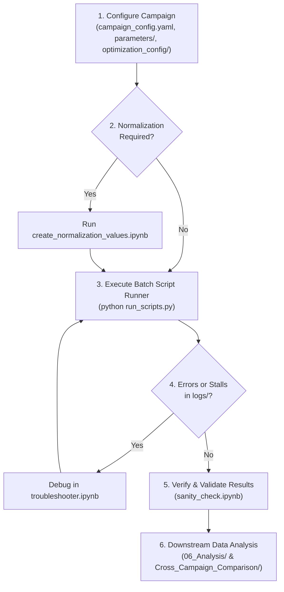

# Bioprocess Operational Mode Screening

A systematic computational screening, optimization, and benchmark for animal cell culture proliferation, conducted specifically for the purpose of cultivated meat process design. This repository investigates bioreactor operational modes, feeding strategies, perfusion strategies, and metabolic kinetics to evaluate process performance metrics such as Space-Time Yield (STY), Medium Efficiency, and Nutrient Use Efficiency.

Developed at **Delft University of Technology, Bioprocess Engineering Section**.

> **Important**: This workspace relies on the [`animakinetica`](https://github.com/BenTumulero/AnimaKinetica) simulation package. All simulation scripts and notebooks must be executed in a Python environment where `animakinetica` is installed.

A snapshot of Animakinetica v1.1.1, used for the creation of this work, was created on the repository Zenodo.
[](https://doi.org/10.5281/zenodo.23339283)

---

## Table of Contents
- [Overview & Objectives](#overview--objectives)
- [Workspace & Campaign Structure](#workspace--campaign-structure)
- [Prerequisites & Installation](#prerequisites--installation)
- [Campaign Execution Workflow](#campaign-execution-workflow)
  - [Step 1: Campaign & Optimization Configuration](#step-1-campaign--optimization-configuration)
  - [Step 2: Generate Normalization Values](#step-2-generate-normalization-values-if-required)
  - [Step 3: Execute Batch Script Runner](#step-3-execute-batch-script-runner)
  - [Step 4: Troubleshooting Simulation Issues](#step-4-troubleshooting-simulation-issues)
  - [Step 5: Sanity Check & Validation](#step-5-sanity-check--validation)
  - [Step 6: Downstream Data Analysis](#step-6-downstream-data-analysis)
- [Evaluated Metrics](#evaluated-metrics)
- [Operating Modes & Operational Strategies](#operating-modes--operational-strategies)

---

## Overview & Objectives

The goal of this project is to perform comprehensive, model-driven comparisons of animal cell culture operating modes under various kinetic formulations and optimization objectives, tailored for cultivated meat production process design. In cultivated meat bioprocessing, maximizing biomass Space-Time Yield while minimizing medium and raw material consumption is critical to economic viability.

Key investigation dimensions include:
* **Stoichiometric Formulations**: Fixed stoichiometric yield representations (e.g., Humbird wildtype and GFI cell lines) vs. dynamic stoichiometric back-coupling.
* **Kinetic Frameworks**: Stoichiometric growth kinetics vs. excess-rate kinetics (Pirt/excess terms).
* **Operating Modes**: Batch, Fed-Batch, Chemostat, Concentrated Fed-Batch, and Continuous Perfusion.
* **Control & Feeding Strategies**: Constant feed, exponential ramp, cell-specific feed (CSFR), cell-specific perfusion (CSPR), toxicity-triggered step/proportional perfusion, and glucose setpoint feedback.

---

## Workspace & Campaign Structure

```
Operational Mode Screening/
├── Campaign_1_fixed_stoichiometry_Humbird/           # Humbird wildtype with fixed stoichiometry
├── Campaign_2_fixed_stoichiometry_GFI/               # GFI cell line with fixed stoichiometry
├── Campaign_3_dynamic_stoichiometry_GFI/             # GFI cell line with dynamic stoichiometry
├── Campaign_4_mode_comparison_excesskinetics/        # Excess kinetics comparison
├── Campaign_5_mode_comparison_adjustedexcesskinetics/# Adjusted excess kinetics comparison
├── Campaign_6_fixed_stoichiometry_Humbird_enhanced/  # Humbird enhanced stoichiometry
├── Cross_Campaign_Comparison/                        # Aggregated cross-campaign notebooks
└── Method Figures/                                   # Synthetic figure generation & workflow diagrams
```

### Standard Campaign Anatomy
Each `Campaign_*` directory contains:
```
Campaign_X_.../
├── campaign_config.yaml              # Master configuration (defaults, modes, runner mapping, opt profile)
├── campaign_normalization.yaml       # Normalization factors generated for optimization
├── create_normalization_values.ipynb # Notebook generating campaign_normalization.yaml
├── run_scripts.py                    # Parallel runner executing mode simulation scripts (*.py)
├── sanity_check.ipynb                # Visual & tabulated validation of campaign simulations
├── simulation_timing.ipynb           # Timing benchmarks across modes
├── troubleshooter.ipynb              # Diagnostic notebook for failed/stalled simulations
├── 01_FedBatch/                      # Fed-batch simulation scripts & local exports
├── 02_Batch/                         # Batch simulation scripts & local exports
├── 03_Chemostat/                     # Chemostat simulation scripts & local exports
├── 04_ConcentratedFedBatch/          # Concentrated fed-batch simulation scripts & local exports
├── 05_ContinuousPerfusion/           # Continuous perfusion simulation scripts & local exports
├── 06_Analysis/                      # Aggregation & summary comparison notebooks
├── logs/                             # Execution logs from run_scripts.py
├── optimization_config/              # Parameter bounds for differential evolution optimization
└── parameters/                       # Parameter sets (base_parameters, cell_properties, operating_modes, stoichiometry)
```

---

## Prerequisites & Installation

1. **Python Environment**: Python 3.13 or newer is recommended.
2. **Install AnimaKinetica**: Install the `animakinetica` simulation package in editable mode or from source:
   ```bash
   pip install -e /path/to/animakinetica
   ```
For further installation instructions, please see the animakinetica repository (https://github.com/BenTumulero/AnimaKinetica).
---

## Campaign Execution Workflow

The campaign execution lifecycle consists of the following 6 steps:

<!--  -->



### Step 1: Campaign & Optimization Configuration
Configure the master settings in `campaign_config.yaml`:
* **Runner Mapping & Parameter Sets**: Specify which parameter files (under `parameters/`) apply to each runner script and operating mode (e.g., base parameters, cell properties, stoichiometry, fed-batch or perfusion configurations).
* **Optimization Profiles (`optimization_settings.active_profile`)**:
  * `baseline_normalized`: Objective metrics are normalized against baseline simulation performance and combined using weighted scoring.
  * `desirability`: Multi-objective optimization evaluated using engineering desirability functions defined with parameter targets, minimum acceptable bounds, and safety caps.
* **Parameter & Bound Modifications**: Adjust parameter values directly in `parameters/` and fine-tune optimization parameter search intervals in `optimization_config/` (named by convention `{Mode}_{Kinetics}_{Target}_{Feed}_{Perfusion}_optimization.yaml`).

### Step 2: Generate Normalization Values (if required)
If using the `baseline_normalized` profile (or when baseline parameter sets have been modified), execute `create_normalization_values.ipynb` to simulate baseline reference runs and generate `campaign_normalization.yaml`.

### Step 3: Execute Batch Script Runner
Execute all mode simulation and optimization scripts in parallel via the batch runner:
```bash
python run_scripts.py
```
`run_scripts.py` discovers all runner scripts across mode folders (`01_FedBatch/` through `05_ContinuousPerfusion/`), manages worker processes, and streams progress live.

### Step 4: Troubleshooting Simulation Issues
If any simulation fails or stalls (indicated in the console or recorded in `logs/`):
* Open `troubleshooter.ipynb`.
* Interactively inspect stalled ODE integrations, event boundary triggers (e.g., nutrient depletion or toxicity cutoffs), or optimizer convergence issues.

### Step 5: Sanity Check & Validation
After completing simulation runs, open `sanity_check.ipynb` to verify data integrity:
* Inspect kinetic rates ($\mu$, $q_{\text{Glc}}$, $q_{\text{Gln}}$, $q_{\text{Lac}}$, $q_{\text{Amm}}$, $q_{\text{O}_2}$, $q_{\text{CO}_2}$).
* Verify state trajectories (biomass, substrate, volume, dissolved gases, pH, base addition).
* Validate mass balances and tabulated summary statistics.

### Step 6: Downstream Data Analysis
Perform custom downstream data analysis and comparative visualizations using notebooks in `06_Analysis/` and `Cross_Campaign_Comparison/`.

---

## Evaluated Metrics

Optimization and evaluation track summary performance metrics calculated in `SimulationData.summary_stats`:
* **Space-Time Yield ($STY$)**: $\text{kg biomass}\cdot\text{m}^{-3}\text{ reactor}\cdot\text{day}^{-1}$
* **Medium Conversion Efficiency**: $\text{m}^3\text{ medium}\cdot\text{kg}^{-1}\text{ biomass}$
* **Feed & Protein Conversion Efficiencies**: $\text{kg feed / protein consumed}\cdot\text{kg}^{-1}\text{ biomass}$
* **Nutrient Use Efficiency**: $\text{kg biomass}\cdot\text{kg}^{-1}\text{ total nutrients}$
* **Total Dry Cell Mass ($DCM$)**: $\text{kg}$

---

## Operating Modes & Operational Strategies

| Operating Mode | Feed Strategies | Perfusion Strategies |
| :--- | :--- | :--- |
| **Batch** | None | None |
| **Fed-Batch** | Constant, Exponential, Linear, CSFR, Glucose Setpoint | None |
| **Chemostat** | Constant | None (constant volume harvest) |
| **Concentrated Fed-Batch** | Constant, Exponential, Linear, CSFR, Glucose Setpoint | Constant, Toxicity-Based (Step/Proportional), CSPR, Glucose Setpoint |
| **Continuous Perfusion** | Constant, Exponential, Linear, CSFR, Glucose Setpoint | Constant, Toxicity-Based (Step/Proportional), CSPR, Glucose Setpoint |

---

## Authors and affiliation

**Ben Tumulero**  
Delft University of Technology, Bioprocess Engineering Section

## License

This project is licensed under the MIT License - see the [LICENSE](LICENSE) file for details.
